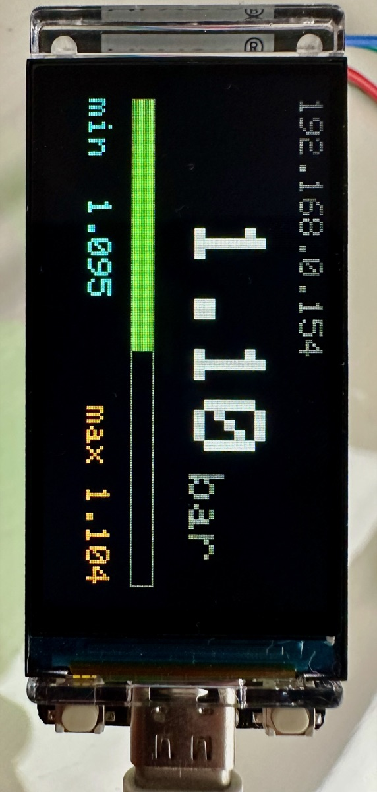

# ESP32 Pressure Monitor

A pressure monitoring node for the ESP32-S3. 
It reads a pressure sensor through an ADS1115, applies a two-point calibration, and serves the result two ways:

- **MQTT** — a JSON snapshot published once per second, for logging and dashboards. Supports Home Assistent auto discovery.
- **XCP on Ethernet** — the same signals observable in real time at task rate
  (down to 1 ms) with CANape or `xcpclient`.

That combination is the point of the project: MQTT gives you the slow, cheap,
always-on data stream, while XCP lets you connect at any moment and watch the
raw signal at full rate without changing the firmware or restarting anything.  
  
So XCP allows you to observe transient pressure peaks in the pipe system, caused by opening and closing taps and valves or pressure peaks from the outside. You may run the XCP measurement as long as needed,but it produces a lot of data. 
MQTT can record long term pressure changes in your home automation system.  
Longer term, slow sampling rate pressure monitoring is usefull to check that pressure regulators, volume expansion tanks and overpressure valves are functional.  




Derived from the `freertos_esp32_demo` example of [XCPlite](https://github.com/RainerZ/XCPlite).


## Hardware

- An ESP32-S3 board compatible with `lilygo-t-display-s3`, or an adapted `platformio.ini`.
- An ADS1115 4 channel I2C ADC at its default address `0x48`.
- Optional, with `OPTION_TEMPERATUR`: a DS18B20 1-Wire temperature sensor and a
  4.7 kΩ resistor.
- A 2.4 GHz WLAN. The ESP32 does not connect to 5 GHz-only networks.
- The board and the PC running CANape or `xcpclient` must be on the same network.

ADS1115 wiring for the LilyGo T-Display-S3:

| ADS1115 | LilyGo T-Display-S3 |
|---------|---------------------|
| VDD     | 3.3 V               |
| GND     | GND                 |
| SDA     | GPIO18 / P1         |
| SCL     | GPIO17 / P1         |
| ADDR    | GND                 |

The pressure sensor is read on **AIN0**. The converter runs at gain 1 (a
+/-4.096 V range) and 860 samples/s, so a conversion fits the default 2 ms
task period. Never drive an ADS1115 input below GND or above its supply voltage,
whatever the configured range.

DS18B20 wiring for the LilyGo T-Display-S3:

| DS18B20 (TO-92 / cable) | LilyGo T-Display-S3 |
|-------------------------|---------------------|
| VDD (red)               | 3.3 V               |
| GND (black)             | GND                 |
| DQ (yellow)             | GPIO21              |
| 4.7 kΩ resistor         | between DQ and 3.3 V |

```
   3.3 V ────────┬──────────────── VDD  (red)
                 │
               4.7 kΩ
                 │
   GPIO21 ───────┴──────────────── DQ   (yellow)

   GND ─────────────────────────── GND  (black)
```

On the bare TO-92 package, flat side facing you and legs down, the pins are
GND, DQ, VDD from left to right. Power the sensor from 3.3 V, not 5 V: DQ
is pulled up to VDD and the ESP32 inputs are not 5 V tolerant. Parasite power
(VDD tied to GND) is not supported by this firmware. For cables longer than a
few meters, use twisted pair for DQ and GND and lower the pull-up to 2.2 kΩ.
Another pin can be chosen with `-DTEMPERATURE_PIN=<gpio>`; avoid the strapping
pins 0, 3, 45 and 46 and the pins of the LCD.


## Quick start

Compile

```bash
cp src/wlan.h.example src/wlan.h   # then edit in your SSID and password
pio run --target upload
pio device monitor                 # note the IP address the board reports and fill in below
```


Start a measurement with the XCPlite xcpclient tool - just the pressure variable, write values to a csv file.  
xcpclient works with ELF or A2L files.  


```bash
xcpclient --udp --dest-addr 192.168.0.ESP  --elf .pio/build/lilygo-t-display-s3/firmware.elf --elf-unit-filter pressure_monitor --default-event slowTask --mea '^pressure$' --csv pressure_monitor.csv
```


Generate the A2L file from the firmware ELF for CANape or other XCP/A2L compliant tools:
(embedding AML needs xcpclient >)

```bash
xcpclient --offline --udp --dest-addr 192.168.0.ESP --elf .pio/build/lilygo-t-display-s3/firmware.elf --a2l CANape/pressure_monitor.a2l --embed-aml --elf-unit-filter pressure_monitor --default-event=slowTask
```

Start a test measurement with xcpclient and the generated A2L file and print pressure values to terminal

```bash
xcpclient --udp --dest-addr 192.168.0.ESP --a2l CANape/pressure_monitor.a2l --default-event=0  --mea '^pressure$'

```


### Getting xcpclient

`xcpclient` is a simple command line XCP client from [XCPlite](https://github.com/RainerZ/XCPlite).
This project uses it for two jobs: generating the A2L from the firmware ELF, and recording measurements to CSV. Note that xcpclient is not a generic A2L creator tool, it works with XCPlite only.  

xcpclient is a Rust program, so you need a Rust toolchain (**1.85 or newer**; install from [rustup.rs](https://rustup.rs)):

```bash
git clone https://github.com/RainerZ/XCPlite
cargo install --path XCPlite/tools/xcpclient
xcpclient --version
```

`cargo install` puts the binary in `~/.cargo/bin`, which rustup adds to your `PATH`.  

For the full option reference see
[tools/xcpclient/README.md](https://github.com/RainerZ/XCPlite/blob/V2.1.10/tools/xcpclient/README.md).


## Measurement and calibration

Measurements, all observable over XCP:

| Signal | Unit | Description |
|---|---|---|
| `pressure` | bar | Calibrated pressure, updated in `slowTask` at task rate |
| `pressure_filtered` | bar | Mean pressure over the last publish interval — the value sent to MQTT |
| `pressure_filtered_samples` | | Number of samples averaged into `pressure_filtered` |
| `pressure_sensor_voltage` | V | Raw sensor voltage on AIN0 |
| `temperature` | degC | DS18B20 temperature, `NaN` while no sensor answers (`OPTION_TEMPERATUR`) |
| `global_counter` | | Free running counter, incremented in `fastTask` |
| `fastTaskOverruns`, `slowTaskOverruns` | | Deadline misses, non-zero when a period is set too aggressively |

Calibration parameters in the `parameters` segment, writable live over XCP:

| Parameter | Unit | Default |
|---|---|---|
| `fast_task_period_ms` | ms | 1 |
| `slow_task_period_ms` | ms | 2 |
| `mqtt_publish_period_ms` | ms | `MQTT_PUBLISH_PERIOD_MS`, default 1000 (clamped to 100 … 3600000) |
| `sensor_voltage_point1` / `pressure_point1` | V / bar | 0.0 / 0.0 |
| `sensor_voltage_point2` / `pressure_point2` | V / bar | 1.0 / 1.0 |

The two calibration points define a straight line; values between and outside
them are interpolated and extrapolated. If both voltage points are equal, the
calibration is degenerate and `pressure` is set to `NaN`.

Calibration segments are accessed through a lock that uses atomics only, with no
blocking mutex held, so XCP can rewrite parameters without disturbing task timing.


## Configuration

Everything is set through `build_flags` in [platformio.ini](platformio.ini).

### Hardware options

| Option | Effect |
|---|---|
| `OPTION_DISPLAY` | Pressure page on the T-Display-S3 LCD (needs LovyanGFX) |
| `OPTION_IO` | Scope trigger pins |
| `OPTION_ANALOG` | ADS1115 analog input |
| `OPTION_TEMPERATUR` | DS18B20 single wire temperature sensor |
| `OPTION_XCP` | Enable XCP |
| `OPTION_MQTT` | MQTT publisher task |
| `OPTION_MQTT_DISCOVERY` | Home Assistant MQTT discovery and availability topic (needs `OPTION_MQTT`) |
| `OPTION_MQTT_SUBSCRIBE` | Receive path for the MQTT task; discovery then re-announces on Home Assistant's birth message |

For a board without the LilyGo display, drop `OPTION_DISPLAY` and remove
`lovyan03/LovyanGFX` from `lib_deps`.

### WiFi credentials

Either copy `src/wlan.h.example` to `src/wlan.h` and edit it — `src/wlan.h` is
gitignored, so credentials never reach the repository — or pass them as build
flags, in which case `wlan.h` is not included at all:

```ini
build_flags =
    -DWIFI_SSID=\"your-ssid\"
    -DWIFI_PASSWORD=\"your-password\"
```

### Display

The display shows the measurement:

```
 192.168.0.ESP

   1.10 bar

 [==========|              ]
 0                          6
 Temp  21.4 °C
```

- Current pressure in large digits, with the unit alongside.
- The bar places the current value on a fixed scale from 0 to 6 bar, clamped at
  both ends. Change the scale with `-DDISPLAY_BAR_MIN=<bar>` and
  `-DDISPLAY_BAR_MAX=<bar>`.
- With `OPTION_TEMPERATUR`, the bottom line shows the DS18B20 temperature with
  one decimal, or `---` while no sensor answers.
- The top line shows the IP address, or the XCP connection state while a tool is
  attached, or `NO SENSOR - sine sim` in red when no ADS1115 was found — so a
  simulated sine wave is never mistaken for a real reading.

The page is redrawn at most once per `DISPLAY_PERIOD_MS` (default 1000), which
is what keeps the digits readable. Each field is drawn with an opaque background
in a fixed-width format and skipped when its text has not changed, so there is
no clear-then-redraw flash.


### MQTT

XCP and MQTT deliberately carry different things. XCP exposes the **raw**
`pressure` at task rate for real-time analysis; MQTT carries the **mean** over
the publish interval, so a once-per-second subscriber gets a filtered value
rather than an arbitrary instantaneous sample.

`slowTask` accumulates every valid `pressure` sample and, once the interval
elapses, divides by the sample count, stores the result in `pressure_filtered`
and hands it to the publisher task. At the 2 ms default that averages about 500
samples per second, which resolves well below one ADS1115 quantization step: raw
readings jump between discrete LSB values, while the filtered output moves
smoothly in the fifth decimal.

The accumulator is a `double`. A long calibrated interval can gather tens of
thousands of samples, and one software `double` add per 2 ms task cycle is far
below the noise floor of the task timing.

The averaging window and the publish period are the same value, and it is an XCP
**calibration parameter** (`parameters.mqtt_publish_period_ms`), so you can
retune it live from CANape without reflashing. It is clamped to 100 … 3600000 ms.

The power-on value is still a build flag, `MQTT_PUBLISH_PERIOD_MS`: it sets the
calibration *default/reference page*, which is what the node starts with and what
CANape shows as the reference value. XCP changes on the working page override it
until the next reset — this build has no persistence, so a calibrated value is
not retained across a power cycle. A `static_assert` rejects a build flag outside
the clamp range, so the startup value can never silently disagree with the A2L.

With `OPTION_TEMPERATUR` the payload also carries `temperature` in °C. It is
the latest DS18B20 conversion, not a mean: a 12 bit conversion takes 750 ms, so
the sensor delivers one value per second anyway. A separate low priority task
owns the 1-Wire bus and the measurement tasks only copy its last result, so the
slow conversion never stalls `slowTask`. Bit-banged 1-Wire disables interrupts
for about 70 µs per bit, which shows up as small task jitter once per second
while the result is read. The task looks for a sensor again every 5 s, so one
that is plugged in later or reconnected is picked up; until then `temperature`
is `null`.

A value that is not available is published as JSON `null` rather than a bare
`nan`, which strict parsers reject.

The slow task never performs network operations: it formats a JSON snapshot into
a one-element mailbox, and a separate low priority task owns the broker
connection, reconnection, and publishing, always sending the newest queued
value. Nothing is published while every sample in an interval is `NaN`.

Defaults:

- Broker `x.ESP.ESP.ESP:1883` (set in `platformio.ini`)
- Topic `pressure_monitor/measurement`
- Payload `{"pressure":1.096658}`, with `OPTION_TEMPERATUR`
  `{"pressure":1.096658,"temperature":21.375000}`
- Publish period 1000 ms, adjustable over XCP
- With `OPTION_MQTT_DISCOVERY`: availability topic `pressure_monitor/status`
  (`online` / `offline`, retained)

Override with build flags:

```ini
build_flags =
    -DMQTT_BROKER_HOST=\"192.168.0.ESP\"
    -DMQTT_BROKER_PORT=1883
    -DMQTT_TOPIC=\"pressure_monitor/measurement\"
    -DMQTT_PAYLOAD_MAX_LENGTH=160
    -DMQTT_PUBLISH_PERIOD_MS=1000
```

For a broker requiring authentication, define both `MQTT_USERNAME` and
`MQTT_PASSWORD`. This project uses unencrypted MQTT; TLS is out of scope.

#### Home Assistant discovery

With `OPTION_MQTT_DISCOVERY` the node announces itself to Home Assistant as one
device, *Pressure monitor*, with the sensor *Pressure*, plus *Temperature* with
`OPTION_TEMPERATUR`, so nothing has to be configured on the HA side.
[src/mqtt_discovery.cpp](src/mqtt_discovery.cpp) holds all of it; `mqtt.cpp`
only calls it at init, after each connect and for received messages.

- After every connect it publishes a device based discovery message to
  `homeassistant/device/pressure_monitor_<chip id>/config` and `online`
  (retained) to the availability topic. The connection carries a last will, so
  the broker publishes `offline` when the node disappears, and HA shows the
  sensors as unavailable instead of keeping the last value.
- Unique ids and the discovery topic are derived from the same chip id as the
  MQTT client id, so several boards never collide in HA's device list. They
  still need their own `MQTT_TOPIC` and `MQTT_AVAILABILITY_TOPIC`.
- The discovery message is about 450 bytes, 700 with the temperature sensor,
  so PubSubClient's packet buffer is enlarged from 256 to 1024 bytes.
- With `OPTION_MQTT_SUBSCRIBE` the node subscribes to `homeassistant/status`
  and re-announces whenever HA publishes `online` there (its birth message).
  The config is then not retained, so a retired node leaves nothing behind on
  the broker. Without it the node only publishes, and the config is retained
  so that the broker hands it to HA after every HA restart.

Plain MQTT subscribers are unaffected: measurement topic and payload stay the
same. See [docs/HOME_ASSISTANT.md](docs/HOME_ASSISTANT.md) for the broker and
HA setup.

```ini
build_flags =
    -DMQTT_AVAILABILITY_TOPIC=\"pressure_monitor/status\"
    -DMQTT_DISCOVERY_DEVICE_NAME=\"Pressure monitor\"
    -DMQTT_DISCOVERY_PREFIX=\"homeassistant\"
```

### XCP

Set in `src/pressure_monitor.cpp`: UDP, port `5555`, project name
`pressure_monitor`. TCP is not supported by the XCPlite FreeRTOS build.


## Project layout

```
platformio.ini            Build configuration, all options live here
extra_script.py           Compiles the vendored XCPlite subset
extra_linker_script.py    ESP-IDF section placement for the XCP metadata
include/                  Module interfaces
src/
  main.cpp                setup() / loop(), startup sequence
  pressure_monitor.cpp    XCP server, tasks, measurements, calibration
  analog.cpp              ADS1115
  temperature.cpp         DS18B20 temperature task
  display.cpp             T-Display-S3 status page
  wifi_sta.cpp            WiFi scan and connect
  mqtt.cpp                MQTT publisher task
  mqtt_discovery.cpp      Home Assistant MQTT discovery and availability
  clock64.c               64 bit microsecond DAQ clock
  wlan.h.example          Template for the gitignored src/wlan.h
xcplite/                  Vendored XCPlite subset (22 files), see below
tools/update_xcplite.sh   Refreshes xcplite/ from an XCPlite repository
docs/HOME_ASSISTANT.md    Mosquitto broker, Home Assistant and Node-RED on a Raspberry Pi
docs/node-red/            Example Node-RED flows: MQTT data and dashboard
CANape/                   CANape project and generated A2L
```


## The XCPlite library

`xcplite/` holds a vendored subset of XCPlite: the 7 source files needed for a
32 bit FreeRTOS target plus the headers they require. `extra_script.py` compiles
them into a static library at build time and puts `xcplite/inc` and `xcplite/src`
on the include path.

The snapshot is committed to this repository, so a fresh clone builds without
fetching anything and without network access. `xcplite/VERSION` records the exact
upstream commit it came from.

The subset is minimal: all 22 files are opened by the compiler on a real build.
It is not a copy of XCPlite — the A2L generator, persistence, shared memory and
the 64-bit queue variants are all disabled by the rtos configuration and absent.

Vendoring rather than submoduling keeps the repository self-contained.

Refresh it with:

```bash
tools/update_xcplite.sh                 # reuse the repo and ref in xcplite/VERSION
tools/update_xcplite.sh --ref V2.3.2   # move to another upstream ref
```

With no arguments the script reuses the repo and ref recorded in
`xcplite/VERSION`, so re-running it reproduces the current snapshot. A local path
is also a valid `--repo`, which is useful for testing an upstream change before
it is pushed:

```bash
tools/update_xcplite.sh --repo ~/git/XCPlite-RainerZ --ref V2.3.2
```

The source list is defined twice, in `XCPLITE_SOURCES` in `extra_script.py` and
in the manifest in `tools/update_xcplite.sh`. Keep them in sync.


## Offline A2L generation

The FreeRTOS build has no filesystem and cannot generate or upload an A2L file,
so the A2L is produced from the firmware ELF on the host with `xcpclient` from
the XCPlite repository:

```bash
xcpclient --offline --udp --dest-addr 192.168.0.ESP --elf .pio/build/lilygo-t-display-s3/firmware.elf --a2l CANape/pressure_monitor.a2l --elf-unit-filter pressure_monitor
```

`--elf-unit-filter pressure_monitor` restricts the A2L to this application
instead of every linked symbol. `--offline --udp --dest-addr` writes the target
address into the A2L; without it the A2L defaults to localhost.
`CANape/XCP_104.aml` must sit next to the generated file, since the A2L includes it.

Expected output: the `fastTask` and `slowTask` events, the `parameters` segment
with its eight members, global and static measurements, supported stack
variables, the `V100` EPK, and the comments and units from the `xcp_meta` section.


## Build and upload

```bash
pio run
pio run --target upload
pio device monitor
```

The serial port is set in `platformio.ini`. Find yours with `pio device list`.
If upload struggles to enter the bootloader, hold BOOT while the upload starts
and release when PlatformIO prints `Connecting...`.

Raise `XCP_LOG_LEVEL` in `src/pressure_monitor.cpp` for more XCP logging
(3 info, 4 XCP commands, 5 debug).


## Network test

Confirm the board reports an IP address in the serial log, then:

```bash
ping <esp32-ip>
```

The XCP server listens on UDP port 5555. A basic connection test:

```bash
xcpclient --udp --dest-addr 192.168.0.ESP
```


## Licence

MIT. The vendored XCPlite subset in `xcplite/` is MIT, Copyright (c) Vector
Informatik GmbH — see `xcplite/LICENSE`.
